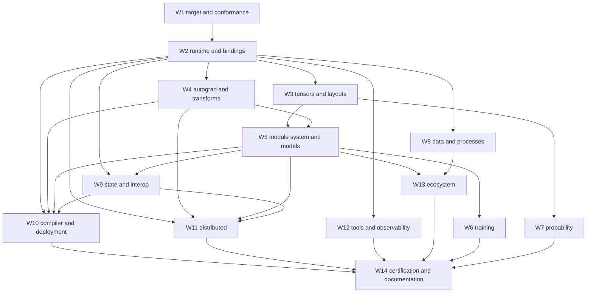

# Full PyTorch Parity Implementation Plan

> **For agentic workers:** REQUIRED SUB-SKILL: Use superpowers:subagent-driven-development (recommended) or superpowers:executing-plans to implement this plan task-by-task. Steps use checkbox (`- [ ]`) syntax for tracking.

**Goal:** Make the complete frozen PyTorch public functionality accessible from Rust, with independently verified native and Python-interoperability profiles.

**Architecture:** Keep LibTorch as the numerical runtime and reuse `tch` first. Close binding and module/autograd/state gaps before dependent compiler and distributed features. Use upstream compiled artifacts and native backends; isolate an optional Python boundary for contracts that require Python execution.

**Tech Stack:** Rust 2024, current Rust 1.88 floor, LibTorch/ATen, `tch`, existing Cargo workspace, standard-library Python inventory/checkers, pinned PyTorch reference programs, existing GitHub Actions and docs.rs release workflow.

**Spec:** [Research, exact baseline, gap map and acceptance model](../specs/2026-09-19-full-pytorch-parity-analysis.md).

## Global Constraints

- Shipping baseline: RustTorch 0.4.0, PyTorch 2.13.0, `tch` 0.26.0; proposed target: PyTorch 2.14.0 at `2b3ec34829036a65cd9d1398ea72a0167dc37470`.
- Preserve the existing Rust 1.88 floor unless a reviewed dependency change requires an explicit migration.
- Use LibTorch kernels and existing RustTorch/tch capabilities before adding dependencies or implementing replacements.
- Native Rust and Python interoperability support must be reported separately.
- No support promotion from a name, reexport, inventory mapping, skipped test or successful documentation build.
- Follow `CONTRIBUTING.md`: issue-first scope/API/dependency/unsafe review, provenance, DCO sign-off, focused pull requests and required CI.
- Never create `codex/` branches; use `b/`, `f/`, `docs/`, `test/` or `chore/` as appropriate.
- Every public change includes Rust examples, executable evidence, compatibility records and GitHub/docs.rs documentation.
- Preserve bounded input parsing, recoverable errors and existing checkpoint/data compatibility; document intentional migrations.

---

## How to execute this plan

This is a program plan, not an instruction to implement a framework in one pull
request. W1–W14 are accountable work packages. Each must be split into reviewed
family-level implementation plans containing exact inventory IDs, Rust APIs,
files, failing tests and measured acceptance gates before implementation starts.
The initial audit tasks below are directly executable. Later API designs depend
on their findings; this document does not invent native interfaces that have not
been shown to exist or be safe.

The eight earlier milestones document the releases through 0.4.0. Tracking issue [#27](https://github.com/newpoluton-alt/RustTorch/issues/27) records program ownership and the reproduced baseline.

## Implementation record, November 2026

- W1 A/B and W14 E have implementation and local test evidence. Use the [shipping census guide](../../api-census.md#find-a-binding-and-run-its-behavior-cases) for exact binding routes, reproducible gaps, and how to run each device case.
- W1 C produced a [migration decision](../../pytorch-2.14-migration.md). The available wheels identify a different source commit from the release tag. RustTorch continues shipping the 2.13 reference.
- Task D has measured native results for CPU generator state, forward AD, callback execution, a compiled package and Gloo. The [native report and four follow-on packets](../../native-runtime-capabilities.md) identify the next production ownership, lifetime and platform tests. Rust exposes scoped gradient recording with unwind restoration.
- W5's first independent layer uses the traced RMS normalization operator for token features. [Issue #28](https://github.com/newpoluton-alt/RustTorch/issues/28) defines its use cases, exact public surface and tests. W2–W14 retain their remaining family and certification gates.

## Delivery order and dependencies

| Stage | Work | Gate to advance |
|---|---|---|
| 0 — establish the actual contract | W1; immediate W14 documentation reconciliation | G0: reviewed target, complete gap/binding inventory, case schema and hardware obligations |
| 1 — remove native blockers | W2; W4 callback/forward-AD probes; W9 native state probes; W12 test infrastructure | G1: safe native boundary demonstrated, runtime upgrade validated or explicitly blocked |
| 2 — complete eager training families | W3, W4, W5, W6, W7, W8, W9 | G2: dense training/state/module contracts pass; each broader family closes only its own cases |
| 3 — advanced execution in parallel | W10 artifact loading then capture/training compile; W11 native groups then distributed models; W13 independently pinned integrations | G3: all declared compiler/distributed/domain subcontracts pass composition and failure tests |
| 4 — certify the frozen target | Remaining W3–W13 obligations; W14 release closure | G4: every required public capability/cell is implemented and verified; no unexplained exclusions |

Do not delay all parallel work until a whole stage ends. W10 artifact-loading
probes and W11 native collective probes can start after G1, while the model team
works on W5/W6. Their final training/capture features depend on the appropriate
W4/W5/W9 contracts. W13 inventory and license research can start during stage 0;
its implementations consume the relevant core/data capabilities.



## File ownership and shared interfaces

Reuse the following files. New files listed here are proposed deliverables,
not existing APIs or permission to create empty scaffolding.

| Area | Existing owners | Planned additions only when used |
|---|---|---|
| Inventory and evidence | `compat/pytorch_reference.toml`, `compat/pytorch_inventory.json`, `compat/pytorch_inventory_map.toml`, `compat/pytorch_api.toml`, `scripts/sync-pytorch-inventory.py`, `scripts/check-compatibility.py`, `tests/test_pytorch_inventory.py`, `tests/test_compatibility_script.py` | `compat/pytorch_bindings.toml`, `compat/pytorch_behavior.toml`; small validation routines in existing checkers |
| Native runtime | `crates/rusttorch-core/src/{lib,device,error}.rs`, root/core `Cargo.toml`, `Cargo.lock`, `crates/rusttorch-cli/src/main.rs` | `docs/native-runtime-capabilities.md`; a native bridge package only if the feasibility report justifies it |
| Model/training core | `src/tensor.rs`, `src/autograd.rs`, `src/distributions.rs`, `src/nn/`, `src/optim.rs`, `src/optim/`, `src/amp.rs` | Focused files for concrete new families when the existing owner would become unreviewable |
| Data | `crates/rusttorch-data/src/`, its existing tests and examples | Spawn-safe process worker files after the process protocol is reviewed |
| State/tools | `src/interop/mod.rs`, `src/checkpoint.rs`, `src/reproducibility.rs`, `src/testing.rs`, `src/profiling.rs` | Exact protocol/native adapter modules established by W2/W9/W12 |
| Compiler/distributed | `src/graph/mod.rs`, `src/deployment/`, `src/distributed/` | Separate loaders/backends when real implementations justify them |
| Reference tests | `tests/python_reference/`, `tests/python_parity.rs`, existing family tests, `scripts/run-python-parity.sh`, `scripts/check-backends.sh` | New case fixtures alongside their family, with immutable source/runtime metadata |
| User documentation | `src/lib.rs`, module rustdoc, package READMEs, `docs/training.md`, `docs/differentiation.md`, `docs/tensor-workflows.md`, `docs/distributed-training.md`, `docs/deployment.md`, `docs/domain-data.md`, `docs/framework-tools.md` | Runnable family recipes included in the same public documentation structure |
| Release | `.github/workflows/ci.yml`, `.github/workflows/release.yml`, `docs/backend-parity.md`, `docs/releasing.md`, `CHANGELOG.md` | Hardware lanes and installed-package tests as claims are added |

W1 produces two reviewed data contracts for downstream work:

- **Binding record:** exact inventory/schema ID, Rust symbol, binding source
  commit/path, route (`existing_tch`, `tch_extension`, `stable_abi`,
  `pinned_cpp`, `rust`, `python_interop` or `unresolved`), and limitations.
  A route describes implementation availability, not supported behavior.
- **Behavior record:** stable case ID, upstream identity/commit, relevant options,
  applicability matrix, execution profile, expected result/error, Rust and
  reference test entry points, tolerance rule, documentation path, and result
  evidence. Results include environment fingerprints and pass/fail/untested/
  upstream-inapplicable status; future expected results are not stored as passes.

These sidecars reference the existing canonical ledger rather than replacing its
status model. Version their schema and reject duplicate IDs, dangling references,
missing proof and unsupported enum values. Keep large generated observations in
test artifacts; commit small reviewable contracts and reproducible generators.

## W1 and initial gates: directly executable audit tasks

### Task A — establish and reproduce the baseline

**Files:** Read `AGENTS.md`, `CONTRIBUTING.md`, the three census/ledger files and
this analysis; record results in `docs/api-census.md` and the implementation issue.
**Interface:** Consumes the existing inventory/map/ledger; produces audited
counts and a source/runtime fingerprint without changing supported status.

- [x] Search existing GitHub issues/PRs and open or update the full-parity
  program issue, linking this plan. Record 2.14.0 as proposed target and 2.13.0
  as current evidence; identify a maintainer for each work package.
- [x] Run the exact count script in the analysis. Expected baseline: 12,462
  identities, 141 rows, 12,179 broad census mappings. Stop and explain a mismatch
  caused by newer source before reusing the historical numbers.
- [x] Run the two offline checks below; preserve the output and commit ID.
- [x] Record which Python-dependent contracts require an optional runtime and
  which can use native equivalents. `python_only` is a disposition, not closure.
- [x] Commit the reviewed scope record with DCO sign-off as a focused docs change.

```sh
.venv/bin/python scripts/sync-pytorch-inventory.py --check
.venv/bin/python scripts/check-compatibility.py --check
```

Expected: both exit zero on the current baseline. No PyTorch import or network
is necessary for these checks. They validate records, not full functionality.

### Task B — make the binding and behavior backlog machine-checkable

**Files:** Create `compat/pytorch_bindings.toml` and
`compat/pytorch_behavior.toml`; modify the existing checkers and
`tests/test_pytorch_inventory.py` / `tests/test_compatibility_script.py`.
**Interface:** Consumes exact shipping 2.13 census IDs; produces the two record types above
and deterministic validation, with no compatibility-status promotion.

- [x] First write rejection fixtures for duplicate/missing IDs, unknown
  ledger targets, an invented Rust symbol, claimed evidence without a test,
  and a hardware skip presented as a pass. An empty binding map must fail
  completeness; it must not be silently populated as supported.
- [x] Run the relevant policy tests and confirm these new cases fail for the
  intended validation reason before implementing the schema checks.
- [x] Trace exact schemas through `tch` generation/native wrappers. Classify
  every 2.13 baseline identity, using `unresolved` with a reason when not established.
  Compile representative calls; do not infer bindings from name similarity.
- [x] Enumerate capabilities outside ordinary object IDs: dtype/device values,
  layouts, memory formats, generators, guards, storage and platform tags. Add
  explicit records with pinned sources and no invented completion results.
- [x] Implement only the validation needed by those records in the existing
  scripts. Re-run negative fixtures, offline validation and deterministic output.
- [x] Generate a gap report grouped by missing binding, missing frontend,
  behavior failure, untested hardware and Python dependency; sign off the commit.

```sh
.venv/bin/python -m unittest discover -s tests -p 'test_pytorch_inventory.py' -v
.venv/bin/python -m unittest discover -s tests -p 'test_compatibility_script.py' -v
.venv/bin/python scripts/sync-pytorch-inventory.py --check
.venv/bin/python scripts/check-compatibility.py --check
```

Expected after implementation: all new rejection cases pass by rejecting the
bad fixture; complete unresolved records are allowed but remain visibly open.

### Task C — produce a 2.13 → 2.14 migration decision

**Files:** Read current manifests/tooling; create
`docs/pytorch-2.14-migration.md`. If the upgrade is approved after the probe,
update `Cargo.toml`, `Cargo.lock`, `pyproject.toml`, `uv.lock`,
`compat/pytorch_reference.toml`, all dependent inventory/checker pins and tests
in a separate implementation PR.
**Interface:** Consumes target commit and binding report; produces an API/behavior
delta and a tested runtime/binding combination, or explicit blocking evidence.

- [ ] Obtain a clean external upstream checkout at the exact 2.14 commit and a
  matching reference runtime. Record source and binary fingerprints; keep both
  outside Git. Generate the new semantic inventory in an isolated worktree.
- [ ] Diff identity, signature/default, registration, dtype/device, archive,
  deprecation and behavior changes. Include boundary-gradient changes from
  the official release, not only newly added names.
- [ ] Reconcile Task B's binding and behavior records against the 2.14 delta.
  G0 for the proposed target requires complete target dispositions, including
  removed/changed entries; a complete 2.13 map alone cannot satisfy it.
- [x] Verify the candidate binding's required LibTorch version and minimum
  Rust/C++ toolchain. Do not use a version-check bypass as the solution.
- [ ] Run tensor creation/backward, a model update, save/load and native linkage
  on Linux, macOS and Windows. Record failed/unsupported configurations.
- [x] Decide from evidence: upgrade all related pins atomically, upstream the
  missing binding patch, or keep the upgrade blocked while 2.13 work continues.
- [ ] For an upgrade, run the full contribution/parity/doc/package gates and
  generate the inventory twice with identical bytes before sign-off.

Do not write a made-up version of `tch` into this plan. The compatible version or
reviewed patch is an output of this task.

### Task D — prove the difficult native boundaries early

**Files:** `crates/rusttorch-core/tests/public_api.rs`,
`tests/autograd.rs`, `tests/deployment.rs`, `tests/distributed.rs`;
create `docs/native-runtime-capabilities.md` with probe results.
**Interface:** Consumes W1 routes; produces a selected implementation route and
lifetime/error/build contract for each probe.

- [x] Probe meta/XPU device representation and a currently unrepresentable
  scalar type; reject an unsupported runtime without invalid native enum casts.
- [x] Probe shared tensor ownership, native RNG state round trip, stream/guard
  restoration, one native forward-AD operation and one custom backward callback.
- [x] Probe loading an upstream compiled AOT package and creating a two-process
  native process group with one collective. Check actual packaged headers/symbols.
- [x] Compare existing `tch`, an upstream `tch` patch, limited stable ABI and
  pinned C++ bridge routes. Measure build/package cost; review licenses/unsafe
  invariants. Add a new crate only if the selected route requires it.
- [ ] Test exceptions/panics at callback boundaries, use after owner drop,
  cancellation, noncontiguous tensors and teardown after errors.
- [ ] Run each supported probe on its applicable platforms; record failures
  as blockers and split W2/W4/W10/W11 implementation plans from the results.

G1 is not satisfied by successful compilation alone. Native ownership and
execution behavior must pass, and inaccessible hardware remains untested.

### Task E — repair known documentation contradictions

**Files:** `docs/pytorch-compatibility.md`, `docs/checkpoint-compatibility.md`,
`docs/deployment.md`, `docs/roadmap.md`, applicable included rustdoc pages.
**Interface:** Consumes current ledger/code/evidence; produces consistent
descriptions of the existing 0.4.0 scopes, without changing scope.

- [x] Replace the stale blanket negatives about PT2/TorchScript and model-state
  formats with the exact scoped deployment/checkpoint behavior.
- [x] Search for other outdated support/non-support statements and compare
  them with the ledger and actual API. Keep upstream references in compatibility
  material and Rust use cases at user-facing entry points.
- [x] Check local links and build affected rustdoc with warnings denied. Run
  any example changed by the correction, then sign off the documentation commit.

## W2 — runtime, devices, dispatcher and extension foundation

**Owners:** `crates/rusttorch-core`, CLI setup, dependency manifests; tests in
`crates/rusttorch-core/tests/public_api.rs`, `tests/device.rs`,
`tests/backend_parity.rs`. **Depends on:** W1 and Task D.
**Produces:** Safe versioned runtime/binding operations used by W3–W12.

- [ ] Complete dtype/device/layout representation through the selected route,
  preserving existing tensor interoperability and explicit conversion errors.
- [ ] Bind native generators, current-device/stream guards, events, synchronization,
  pinned/async copies, allocation statistics, deterministic/precision policies,
  graph capture and peer operations where the target supports them.
- [ ] Expose dispatcher/custom-op registration with schema/alias declarations,
  kernel selection, metadata/fake behavior, autograd/batching/decomposition rules
  and registration lifetime. Cover custom classes and extension loading.
- [ ] Add build-time and runtime capability checks and installation recovery
  messages; test the supported compiler, ABI, driver and native-library tuples.

**Initial prerequisite gate:** Representation, ownership, guards and dispatcher
registration pass; one custom operator completes eager forward/backward and
metadata execution. Incorrect schemas and unsupported kernels fail safely.
Guards restore state after errors; native handles are destroyed correctly;
asynchronous copies have validated stream ordering.

**Final integration acceptance:** That operator also completes batching with W4
and export/compiled execution with W10. These later checks do not block starting
W4/W10, but remain required for full W2 completion. Stable ABI availability never
substitutes for operator conformance.
See [custom-op contracts](https://docs.pytorch.org/docs/2.14/library.html).

## W3 — complete tensors and specialized layouts

**Owners:** `src/tensor.rs`, existing raw bindings, `tests/tensor_workflows.rs`,
`tests/python_reference/tensor_workflows.py`, `docs/tensor-workflows.md`.
**Depends on:** W1/W2. **Produces:** Tested operator/layout contracts used by
models, probability, transforms and graph execution.

- [ ] Close existing-binding cases first: creation, indexing, shape/stride/views,
  scalar conversion, broadcasting/promotion, reductions, comparisons, sorting,
  scatter/gather, random, linalg, FFT, special and signal operations.
- [ ] Test every required overload, optional argument/default, `out` and
  in-place form; include zero-size/scalar/noncontiguous/overlapping views, NaN/Inf,
  signed zeros, integer overflow behavior and invalid shape/type/device inputs.
- [ ] Complete storage/view/version-counter and memory-format behavior; preserve
  alias/mutation semantics across interchange and differentiation.
- [ ] Close complex, COO/CSR/CSC/BSR/BSC, nested/jagged, masked, quantized and
  low-precision/shell-dtype families against their actual upstream applicability.
  Internal schemas needed to implement public functionality may be bound without
  turning them into public compatibility promises.

**Acceptance:** Each exact schema and applicable case has forward/metadata/error
evidence and supported derivative evidence. Numerical comparison cannot hide
wrong strides, ownership, mutation or device placement. No handwritten duplicate
kernel is added when LibTorch already supplies it.

## W4 — autograd, function transforms and activation recomputation

**Owners:** `src/autograd.rs`, `tests/autograd.rs`,
`tests/python_reference/differentiation.py`, `docs/differentiation.md`.
**Depends on:** W2, relevant W3 cases; W5 for functional model transforms.
**Produces:** Safe hooks/custom derivatives and composable differentiation.

- [ ] Implement native forward AD with dual-level lifetime, multi-input/output
  reverse derivatives, higher-order and complex/sparse behavior where supported.
- [ ] Add custom backward/JVP/batching rules, saved tensors and graph hooks,
  anomaly/debug controls, retain/create-graph and unused-gradient semantics.
- [ ] Complete `vmap`, grad/VJP/JVP, Jacobians/Hessians, linearization,
  functionalization and functional module/state transforms with composition.
- [ ] Add activation checkpointing as recomputation, separately from disk
  checkpoints: reentrant/non-reentrant and selective policies, RNG preservation,
  hooks and early-stop behavior supported by the frozen target.

**Acceptance:** Compare `vmap(grad(...))`, forward-over-reverse and
reverse-over-forward results; test view mutation/version errors, disconnected
inputs, hook removal/reentrancy, callback failures and graph destruction.
Checkpointed dropout training must preserve required RNG/gradient behavior and
show measured peak-memory reduction. [Checkpoint contracts](https://docs.pytorch.org/docs/2.14/checkpoint.html).

## W5 — module semantics, complete models and functional forms

**Owners:** `src/nn/`, `tests/nn_layers.rs`, `tests/nn_spatial.rs`,
`tests/nn_sequence.rs`, `tests/training_losses.rs`, their reference generators,
`docs/training.md`. **Depends on:** W3/W4; can finish independent existing-binding
layers before all W4 work. **Produces:** Model/state/hook contracts for W6/W9/W10/W11.

- [ ] Review an additive Rust module/input-output-tree design: recursive named
  modules, parameters, persistent/nonpersistent buffers, tied storage, training
  state, hooks, extra state and state_dict loading transformations.
- [ ] Complete containers, lazy/meta construction, initialization, parametrizations,
  pruning and all remaining layer/functional/loss variants in the exact census.
- [ ] Finish recurrent cells and packed/nested paths, attention dimensions and
  masks, specialized pooling/padding/activation families, and distributed
  normalization with W11. Audit attention backend selection separately.
- [ ] Add end-to-end classifiers, sequence models and custom multi-output models
  that exercise model construction, training, evaluation and persistence.

**Acceptance:** Match defaults, initialization policy, parameter/buffer names,
sharing, forward values and all gradients; recursively preserve train/eval and
state behavior. A matching class name or a rejected option setter is not a
completed configuration. Include a migration path for any changed public trait.

## W6 — optimizer, scheduling and mixed-precision completion

**Owners:** `src/optim.rs`, `src/optim/`, `src/amp.rs`, optimizer/state/AMP tests,
`tests/python_reference/training.py`, `tests/python_reference/optim_state.py`.
**Depends on:** W2/W4/W5/W9 where used. **Produces:** Complete training transitions.

- [ ] Implement the target's remaining optimizer families, beginning with the
  gaps identified in the analysis, then audit the full frozen catalog.
- [ ] Complete closures, parameter groups, missing/zero/sparse/complex gradients,
  state hooks and supported maximize/foreach/fused/capturable/differentiable modes.
  Distinguish unsupported upstream combinations from missing RustTorch behavior.
- [ ] Complete scheduler families/composition, per-group state, averaging/SWA/EMA
  utilities and optimizer-state interchange with W9.
- [ ] Finish applicable device/dtype autocast policies and gradient scaling,
  overflow handling, accumulation, clipping and distributed/compiled interaction.

**Acceptance:** Compare many-step and resumed trajectories, including closure
reevaluation, learning-rate boundaries, absent gradients, nonfinite gradients
and state migration. Fused/foreach claims need actual selected execution paths;
matching output from a fallback loop alone does not prove their functionality.

## W7 — probability distributions, transforms and constraints

**Owners:** `src/distributions.rs`, `tests/distributions.rs`,
`tests/python_reference/differentiation.py`, `docs/differentiation.md`.
**Depends on:** W2 RNG and relevant W3/W4 operators.
**Produces:** Complete probability API families with validated shape semantics.

- [ ] Inventory and implement every frozen distribution, method/property,
  support constraint, transform, independent/transformed wrapper and KL rule.
- [ ] Specify sample/batch/event shapes, expansion, validation, reparameterized
  sampling and native generator behavior, including invalid-domain cases.
- [ ] Test log-probability tails, entropy, moments, CDF/inverse CDF and discrete
  enumeration where upstream supplies them; verify gradients and composition.

**Acceptance:** Analytic/differential checks plus statistically sound sampling
tests. RNG identity is tested only for the specified native build/algorithm;
statistical equivalence is reported separately.

## W8 — DataLoader and multiprocessing functionality

**Owners:** `crates/rusttorch-data/src/{worker,stream,loader,collate,sampler}.rs`,
existing worker/checkpoint tests and crate README; new process implementation
only after protocol review. **Depends on:** W2/W9 for native RNG and IPC.
**Produces:** Explicit native-thread and compatible-process execution contracts.

- [ ] Add a differential case with two uneven iterable worker shards: verify
  worker-local incomplete-tail handling against upstream and retain the current
  global batching behavior as an explicitly named native option.
- [ ] Implement spawn-safe process task/IPC registration with bounded messages,
  ownership rules, worker initialization/persistence, shutdown and failure
  propagation. Arbitrary Rust closures cannot be assumed pickle-compatible.
- [ ] Complete sampler/generator state, arbitrary-key and structured collation
  boundaries, worker seeding, pinning/async transfers, process sharing and
  relevant core/TorchData compatibility paths.
- [ ] Test supported checkpoint combinations separately from upstream core
  DataLoader, which does not gain a checkpoint API just because RustTorch has one.
- [ ] Retain and extend Windows regressions for queued records, deadline expiry,
  final acknowledgments, cancellation and exhaustion. Use channels/barriers to
  enforce order; stress repetition supplements rather than replaces those proofs.

**Acceptance:** Identical specified sample/batch traces and state transitions
across worker counts; no duplicate/lost records, leaked processes or deadlocks
on Windows/Linux/macOS. Document noncooperative-thread limits and actual process
termination semantics. Test CUDA pinning on CUDA hardware.

## W9 — serialization, state and Python interoperability

**Owners:** `src/interop/mod.rs`, `src/checkpoint.rs`, `src/reproducibility.rs`,
`tests/interop.rs`, `tests/training_checkpoint.rs`, existing import/export scripts,
`docs/checkpoint-compatibility.md`. **Depends on:** W2/W5; coordinates W6/W8/W11.
**Produces:** Versioned state/artifact protocols and explicit interoperability.

- [ ] Complete native tensor/storage serialization, aliases/views, map-location,
  byte order/mmap where supported, state_dict hooks/extra state and optimizer
  mappings; preserve typed SafeTensors workflows as their own useful format.
- [ ] Add native per-device RNG save/restore/fork and exact supported continuation
  across model, optimizer, scaler, scheduler and loader state.
- [ ] Specify the optional trusted Python-object boundary for arbitrary classes,
  subclasses, pickle/package/hub execution and dynamic registries. Separate
  offline conversion from live identity/autograd sharing and document the GIL,
  runtime loading, ownership and callback restrictions of each.
- [ ] Complete DLPack/array/buffer interchange with stream/lifetime/read-only
  semantics; bind supported shared-memory and multiprocessing contracts.
- [ ] Add native distributed-checkpoint format interoperability with W11,
  explicitly versioned rather than implying cross-version format guarantees.

**Acceptance:** Python→Rust→Python values, storage sharing and state round trips;
continued training has matching next steps under the frozen configuration.
Corrupt/truncated/oversized artifacts fail without partial live-state mutation.
Executable Python objects are never silently accepted by a data-only loader.
[Serialization semantics](https://docs.pytorch.org/docs/2.14/notes/serialization.html).

## W10 — export, compilation and deployment

**Owners:** `src/graph/mod.rs`, `src/deployment/`, `tests/graph.rs`,
`tests/deployment.rs`, `tests/python_reference/deployment.py`,
`docs/graph-compilation-roadmap.md`, `docs/torch-export-roadmap.md`,
`docs/deployment.md`. **Depends on:** W2/W3/W4/W5/W9 as each subtrack requires.
**Produces:** Separate artifact-execution, capture, compiler and legacy contracts.

- [ ] Deliver upstream AOT compiled-package execution through the proven native
  route first. Validate package type, runtime/toolchain/device and schema guards.
- [ ] Complete ExportedProgram/PT2 graph signature, state/mutation/alias and
  symbolic constraint handling, supported control-flow operators and custom ops.
  Prefer existing upstream execution/lowering facilities to a second compiler.
- [ ] Design Rust capture with explicit treatment of control flow, side effects,
  mutation, aliases and dynamic shapes; provide FX-equivalent transformation and
  inspection capabilities. Never promise capture of arbitrary Rust closures.
- [ ] Integrate forward/backward capture, functionalization, decompositions and
  upstream compiler backends; validate caches, invalidation and diagnostic behavior.
- [ ] Supply an explicit Python capture/compiler route for Python-authored
  programs and CPython-dependent behavior; keep that result separate from native
  capture and Python-free artifact deployment.
- [ ] Complete target ONNX export/opset/operator contracts and NativeRT integration;
  retain a separately tracked legacy TorchScript public-API compatibility lane.

**Acceptance:** Dynamic CNN, recurrent, Transformer/cache, tied-state,
multi-output, conditional/loop, mutation and custom-op cases compare eager,
exported and compiled values/gradients where applicable. Wrong guards and
unsupported artifact versions fail explicitly. Measure compilation latency,
warm execution, memory and cache reuse independently.
[Export IR](https://docs.pytorch.org/docs/2.14/user_guide/torch_compiler/export/ir_spec.html),
[ONNX](https://docs.pytorch.org/docs/2.14/onnx.html).

## W11 — full distributed functionality

**Owners:** `src/distributed/{mod,process,training}.rs`, `tests/distributed.rs`,
`tests/python_reference/distributed.py`, `docs/distributed-training.md`.
**Depends on:** W2 streams/dispatch, W4 callbacks, W5 module state, W9 persistence.
**Produces:** Native communication and composable parallel-training contracts.

- [ ] Bind native stores/process groups and applicable Gloo/NCCL/other target
  backends; implement async work/futures, subgroup lifetime, launch/rendezvous,
  timeout/abort and stream ordering. Keep CPU TCP as its existing distinct backend.
- [ ] Complete DDP automatic reducers, bucketing/overlap, hooks, unused/shared
  parameters, accumulation and uneven-input join behavior.
- [ ] Add DeviceMesh/DTensor placements and operator sharding propagation, then
  target FSDP1/FSDP2, tensor parallel and pipeline parallel behavior.
- [ ] Complete distributed optimizers, checkpoint planners/formats/resharding,
  elastic restart, RPC and target specialized collective/symmetric-memory APIs.
- [ ] Validate documented composition with AMP, compile, custom operators and
  activation checkpointing rather than treating each subsystem in isolation.

**Acceptance:** Same-reference multi-step losses, gradients, parameters and
optimizer state; actual sharded residency and measured overlap; mixed-language
peers where advertised. Rank loss/timeouts terminate without deadlock and
recovery restores correct state. Test multiple groups and world-size changes
on real multi-device/multi-node systems. Match upstream platform restrictions,
including Windows backend restrictions, instead of simulating successful support.
[DTensor](https://docs.pytorch.org/docs/2.14/distributed.tensor.html),
[FSDP2](https://docs.pytorch.org/docs/2.14/distributed.fsdp.fully_shard.html),
[distributed checkpoints](https://docs.pytorch.org/docs/2.14/distributed.checkpoint.html).

## W12 — testing, profiling and framework utilities

**Owners:** `src/testing.rs`, `src/profiling.rs`, `src/reproducibility.rs`,
`tests/framework_tools.rs`, `tests/python_reference/framework_tools.py`,
`docs/framework-tools.md`. **Depends on:** W2/W4 as applicable.
**Produces:** Conformance tools and native observability for all workstreams.

- [ ] Complete comparison/tensor-factory/gradient-check utilities across nested,
  complex, sparse, quantized and multi-input cases. Include negative controls
  that demonstrate detection of deliberately wrong gradients and metadata.
- [ ] Bind native operator/kernel/memory profiling, scheduling, correlation,
  shapes/stacks and applicable CPU/CUDA/XPU activities. Keep host spans labeled
  as host spans. Add monitor/logging/module tracking where present in the target.
- [ ] Complete benchmark measurement behavior with calibrated timers, backend
  synchronization, warmup, variance/raw samples and applicable instruction tools.
- [ ] Inventory and close remaining utility namespaces: futures, environment/
  build configuration, deterministic/backend controls, hub/package/model-zoo,
  TensorBoard and supported extension tools, coordinating W2/W9/W13 ownership.

**Acceptance:** Known asynchronous kernels and allocations appear with correct
correlation; overhead is measured. RNG/guard state survives success and failure.
Every remaining documented utility has an explicit implemented route or stays
open. [Profiler](https://docs.pytorch.org/docs/2.14/profiler.html),
[testing](https://docs.pytorch.org/docs/2.14/testing.html),
[benchmarking](https://docs.pytorch.org/docs/2.14/benchmark_utils.html).

## W13 — domain libraries and separately versioned integrations

**Owners:** Existing `crates/rusttorch-{vision,audio,codec,text,tabular}` source,
tests, README/COMPATIBILITY files and `docs/domain-data.md`.
**Depends on:** W1 plus relevant W3/W5/W8/W10 contracts.
**Produces:** Per-project compatibility manifests and complete domain workflows.

- [ ] Create independent pinned inventories for torchvision, torchaudio,
  torchcodec and torchao. Audit their actual version compatibility with the
  selected torch target instead of assuming matching version numbers.
- [ ] Vision: close transforms/operators/datasets/feature extraction and model
  architectures; separately validate weight loading and exact preprocessing for
  classification, detection, segmentation, video and optical-flow workloads.
- [ ] Audio/codec: complete DSP conventions/gradients, models/pipelines/datasets,
  encoding/decoding/seek/multistream behavior and supported hardware paths.
  Follow TorchAudio's move toward TorchCodec rather than duplicating obsolete I/O.
- [ ] Text/data: explicitly pin historical torchtext coverage and current
  TorchData state/node functionality. A tokenizer adapter is not the entire
  legacy text library; old DataPipes and current nodes have distinct contracts.
- [ ] Quantization: cover the target's legacy behavior and separately pinned
  torchao PTQ/QAT, low-bit formats, kernels and export pathways.
- [ ] Inventory official extension tracks including ExecuTorch, XLA,
  TorchRec and TorchRL/TensorDict; assign separate integration contracts and
  hardware requirements. Review serving lifecycle before selecting a server.
  Do not imply universal compatibility with all third-party Python packages.
- [ ] Record code/model/dataset licenses, checksums and conversion recipes;
  require explicit user action for downloads in examples. Keep native tabular
  additions outside the core PyTorch conformance denominator.

**Acceptance:** Each contracted library closes its own exact public inventory
and real end-to-end workflows. A passing pipeline or a matching package name
does not establish complete ecosystem coverage. TorchText's final-release
constraint and TorchData's removed APIs are historical targets, not current torch
features. [TorchText lifecycle](https://github.com/pytorch/text/issues/2250),
[TorchData direction](https://docs.pytorch.org/data/0.11/getting_started_with_torchdata_nodes.html),
[TorchAudio migration](https://docs.pytorch.org/audio/main/torchaudio),
[TorchCodec](https://github.com/meta-pytorch/torchcodec).

## W14 — continuous documentation, certification and release

**Owners:** All affected public rustdoc/READMEs/guides, canonical ledger and
generated coverage, `CHANGELOG.md`, CI/release workflows and release guide.
**Depends on:** Each shipped family; final closure depends on all core obligations.
**Produces:** Usable Rust APIs and accurate GitHub/docs.rs claims at every release.

- [ ] Each family ships a task-oriented example: input shapes/types, configuration,
  complete runnable code, expected result, training/inference use, errors and
  limits. Link facade and standalone crate paths, particularly DataLoader.
- [ ] Test examples and doctests with real runtime features; separately build the
  docs.rs `doc-only` profile. A network-free docs build is not runtime evidence.
- [ ] Reconcile support summaries with ledger scope; run link and stale-claim
  review. Keep implementation diaries in plans and user instructions in guides.
- [ ] Execute required CPU OS lanes, real MPS/CUDA/ROCm/XPU lanes where claimed,
  multi-node lanes and native codec/compiler-package lanes. Publish environment
  fingerprints and distinguish pass/fail/untested/inapplicable.
- [ ] Validate packaged-crate consumers, dependency licenses/provenance, binary
  loading and feature combinations before publishing. Follow the existing
  coordinated nine-crate sequence and immutable release-tag policy.
- [ ] Publish release notes and exact supported scope; verify GitHub artifacts
  and docs.rs pages after crates.io publication. Never describe a local rustdoc
  build as a docs.rs deployment.
- [ ] At each upstream stable release, regenerate the version delta and run
  change-specific regressions. Assign an owner to every newly discovered public
  capability before claiming support for the new version.

**Final gate G4:** No in-scope required capability remains unresolved, planned,
partially covered or untested; every native/Python route is identified; all
applicable behavioral cells pass; all documented exceptions are upstream
limitations rather than hidden RustTorch gaps. Publish the exact version/profile/
platform contract. Until then, report completed families and remaining gaps.

## Verification used for each implementation packet

Before coding, the family plan must contain the concrete failing reference case,
Rust test code, selected native interface and exact expected errors. Then:

1. Run the failing case and preserve the failure that demonstrates the gap.
2. Implement the smallest complete family slice using the selected existing
   runtime route. Review any unsafe/callback/ownership boundary.
3. Re-run focused Rust/reference cases, including negative/edge cases and each
   affected backend. Run cross-feature cases for contracts changed by the patch.
4. Update evidence/ledger, regenerate coverage and execute the relevant examples.
5. Run all required contribution checks; review the diff, sign off and submit a
   focused PR through required CI. Never bypass protected main.

Commands already provided by this repository include:

```sh
.venv/bin/python scripts/sync-pytorch-inventory.py --check
.venv/bin/python scripts/check-compatibility.py --write
.venv/bin/python scripts/check-compatibility.py --check
.venv/bin/python -m unittest discover -s tests -p 'test_*.py' -v
cargo fmt --all -- --check
cargo check --workspace --all-targets --features rusttorch/full
cargo clippy --workspace --all-targets --features rusttorch/full -- -D warnings
cargo test --workspace --all-targets --features rusttorch/full
cargo test --workspace --doc --features rusttorch/full
scripts/run-python-parity.sh
scripts/check-backends.sh
```

Use `scripts/dev-env.sh` and the audited FFmpeg setup described in
`CONTRIBUTING.md` before runtime checks. Complete its documentation/package/DCO
checks as well; this excerpt does not replace the contribution rules. New test
families must be included in the parity runner, not only run manually once.

## Resourcing, progress and estimates

Assign accountable owners for six concurrent concerns: runtime/bindings,
core models/training, compiler, distributed, data/ecosystem, and
conformance/docs/release. These are skill responsibilities, not an assertion
that six people can finish the program in a fixed duration.

Provision hardware before promising backend completion. Each delivery report
must list closed capability IDs, remaining options, exercised environments,
open blockers and the next dependency gate. Measure representative W2/W4/W10/W11
deliveries before assigning date ranges to their dependent work. Hardware access,
binding review and upstream fixes can dominate calendar time.

Recommended first delivery is **Tasks A–E and G0/G1 evidence**, followed by
complete eager-model/training families while compiled-artifact and native
distributed work run in parallel. This replaces arbitrary quarterly percentages
with reviewable behavior and a finish condition that can actually be tested.
